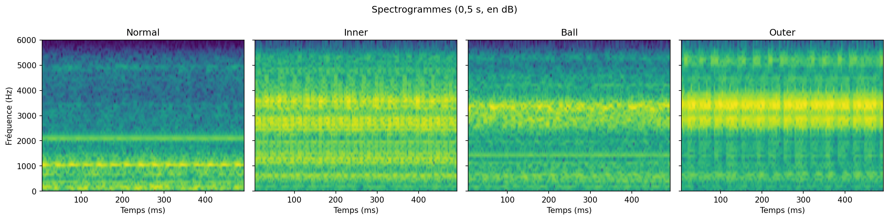
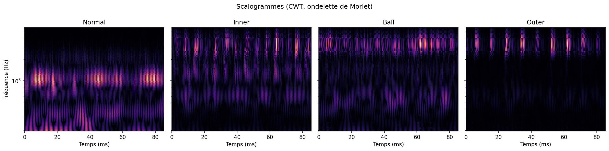
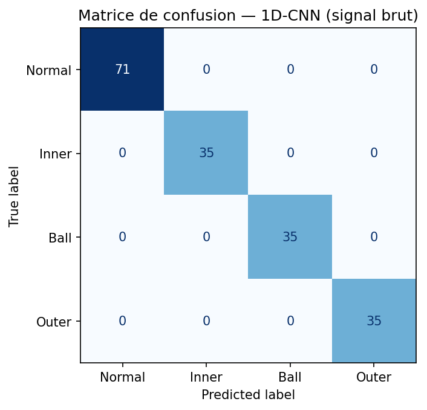
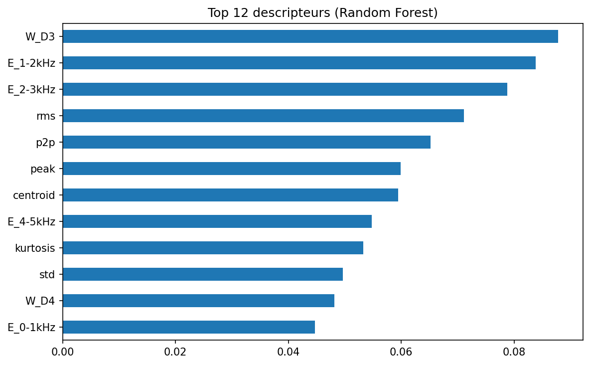
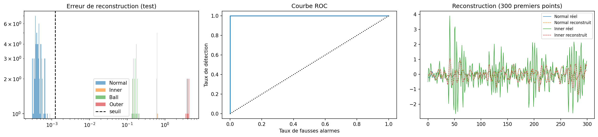
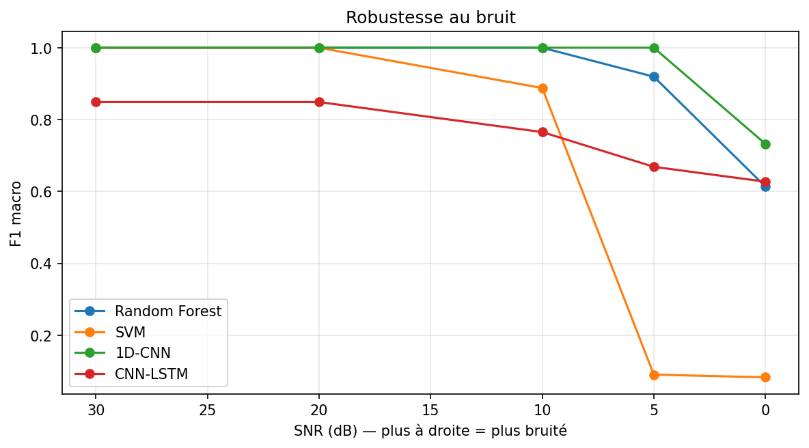

# Détection de défauts sur signaux vibratoires : Traitement du signal, ML et Deep Learning

Pipeline complet de **détection et classification de défauts** à partir de **séries temporelles** (signaux de vibration de roulements, dataset CWRU) : de l'analyse du signal (FFT, STFT, ondelettes) aux modèles de Machine Learning et de Deep Learning, jusqu'à la détection d'anomalies non supervisée.

> **Open in Colab :** ouvrir `fault_detection_cwru.ipynb` dans Google Colab, puis `Exécution > Tout exécuter`.

## Objectif

Classer des fenêtres de signal de 1024 points (≈ 85 ms à 12 kHz) en 4 classes : **Normal**, **Inner race**, **Ball**, **Outer race**. Détecter ensuite les défauts **sans données de défaut** grâce à un autoencodeur.

La méthode se transpose directement à d'autres signaux industriels, par exemple la **détection d'arcs électriques** dans le courant d'un réseau électrique.

## Pipeline

```
Signal brut (12 kHz)
   │
   ├─ Séparation train/test TEMPORELLE (70/30), puis fenêtrage 1024 pts  → pas de fuite de données
   │
   ├─ Analyse du signal : FFT · Spectrogramme (STFT) · Scalogramme (CWT Morlet)
   │
   ├─ Approche 1 : 23 descripteurs (temporels, fréquentiels, énergies DWT db4)
   │                → Random Forest, SVM (RBF)
   │
   ├─ Approche 2 : signal brut → 1D-CNN, CNN-LSTM (TensorFlow/Keras)
   │
   ├─ Approche 3 : Autoencodeur convolutif entraîné sur le « Normal » uniquement
   │                → erreur de reconstruction = score d'anomalie
   │
   └─ Évaluation : F1 macro, matrices de confusion, ROC/AUC, robustesse au bruit (SNR 30 → 0 dB)
```

## Résultats

| Modèle | Entrée | Accuracy | F1 macro |
|---|---|---|---|
| Random Forest | 23 descripteurs | XX | XX |
| SVM (RBF) | 23 descripteurs | XX | XX |
| 1D-CNN | signal brut | XX | XX |
| CNN-LSTM | signal brut | XX | XX |
| Autoencodeur (Normal vs Défaut) | signal brut, non supervisé | XX | XX |

*(Remplacer XX par les valeurs du tableau final du notebook.)*

### Analyse temps-fréquence



### Classification



### Détection d'anomalies (autoencodeur)


### Robustesse au bruit


## Points méthodologiques

- **Pas de fuite de données :** les signaux sont coupés dans le temps *avant* le fenêtrage. Le fenêtrage avec chevauchement + un split aléatoire donne des scores artificiellement parfaits.
- **Classes déséquilibrées :** poids de classe et F1 macro.
- **Normalisation** calculée sur le train uniquement.
- **Test de robustesse :** modèles entraînés sur signaux propres, testés avec bruit blanc gaussien à SNR décroissant.

## Limites et perspectives

- Dataset de laboratoire (une vitesse, une taille de défaut). Les scores élevés ne garantissent pas la généralisation.
- Pistes : transfert de domaine (autres charges moteur), augmentation par bruit, scalogrammes + CNN 2D, **GAN / VAE** pour générer des données de défaut synthétiques, Transformers pour séries temporelles.

## Stack

Python · NumPy · SciPy · PyWavelets · scikit-learn · TensorFlow/Keras · Matplotlib · Pandas

## Données

[CWRU Bearing Data Center](https://engineering.case.edu/bearingdatacenter) : fichiers 97 (Normal), 105 (Inner race 0.007"), 118 (Ball 0.007"), 130 (Outer race 0.007" @6:00), 12 kHz, accéléromètre Drive End.

## Auteur

**Maher Ben Aicha** : élève ingénieur, ENIT (Tunis)
